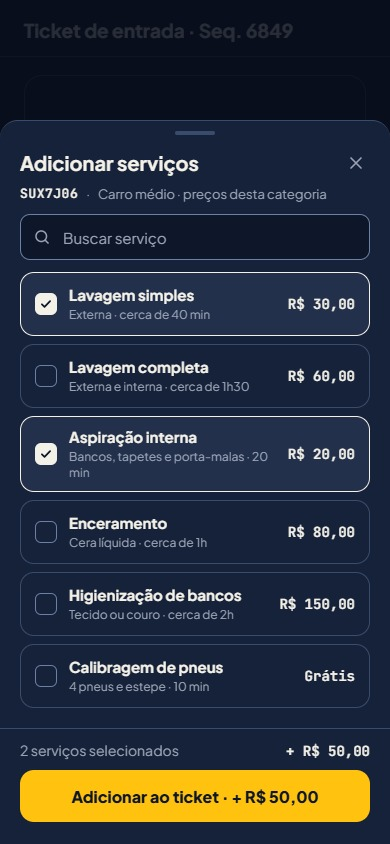
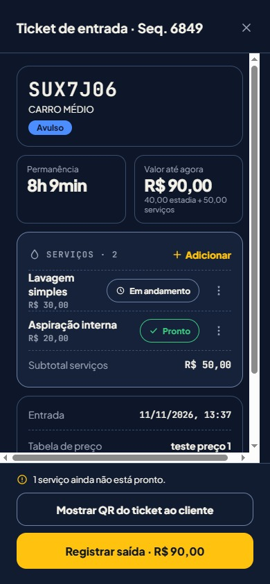
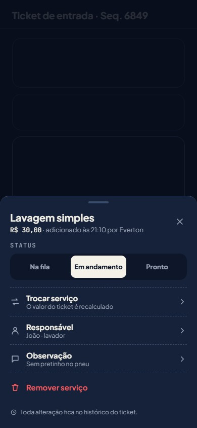
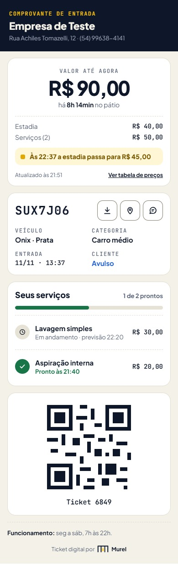

melhorar layout do serviço

na tela do item do patio deve ficar assim 
ao clicar em adicionar 
depois de adicionado 
detalhes de um serviço 
no comprovante de entrada quando tiver um serviço 

no endpoint de comprovante/cliente foi adicionado o "servicos": [
{
"nome": "Lavagem",
"valor": 100.00,
"status": 2,
"statusDescricao": "Em execução"
}
],
